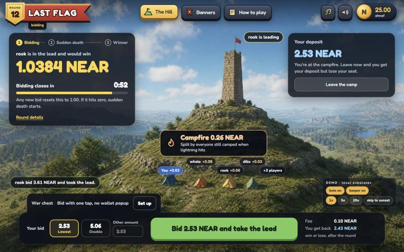
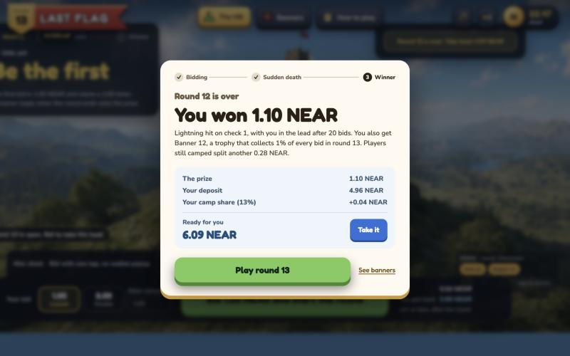

# Last Flag

A no-loss last-bidder game on NEAR, played as King of the Hill. Every bid plants your flag on
top of the tower and puts the sun back to noon. When the sun sets a storm rolls in, and every
block the bell rings with a small chance of lightning. When it strikes, the flag on top wins a
banner NFT that holds most of the tower: the prize, made of fees and, on the demo params, a
funded mock yield. The tents still standing split the rest. Everyone takes 96% of every bid back.
The banner then earns 1% of every bid in the next hill. There is a hard cap, no owner and no admin
key, and whoever rings the striking bell gets a small reward.

Built at NEAR HACKATHON. The repository's history starts on 3 Nov 2026.

| | |
| --- | --- |
| Simulator in the browser, nothing to install | https://last-flag-psi.vercel.app/?sim |
| Live testnet game | https://last-flag-psi.vercel.app/ |
| Contract | [`lastflag-v2.testnet`](https://testnet.nearblocks.io/address/lastflag-v2.testnet) |
| Rules, with the live and demo numbers | [RULES.md](RULES.md) |



## The problem

Last-bidder games (Fomo3D and its copies) have two known faults:

- **Everyone but the winner loses their bids.** The prize is other players' money.
- **The end is a visible countdown.** The game goes to whoever can snipe the last second or
  stuff the final blocks. Fomo3D's first round was won by block stuffing in 2018.

Last Flag changes both:

- **A bid is a deposit.** 96% of it comes back, win or lose. The prize is made of the 3% fee
  only.
- **There is no last second.** Once the sun sets, every block has the same 5% chance of ending
  the hill, so there is no final block to snipe or stuff.

The game also runs without an operator. Parameters are fixed at deploy, anyone can ring the
bell, and the ringer whose bell strikes is paid from the tower.

## Try it in 1 minute

Open https://last-flag-psi.vercel.app/?sim. The simulator runs the whole game in the browser.
No wallet, no chain, nothing to install.

1. The page opens on **How to play**. Click **The Hill** in the header. You see the tower with
   the leader's flag, a **Bidding closes in** timer top left, and the bots (`whale`, `sniper`,
   `dibs`, `moss`, `pip`, `rook`) already bidding.
2. Click **CONNECT** (top right). You get a mock wallet, `ahnaf.testnet`, with 25 NEAR.
3. Click **Bid ... NEAR and take the lead** in the bottom tray. Your block drops onto the
   tower, your flag goes up and the timer resets.
4. In the **DEMO** panel (bottom right), click **skip to sunset**, then **5x**. Night falls and
   rain starts. The keeper rings the bell; every bell is a lightning bolt that misses.
5. Within seconds a bolt hits the tower: the strike. A window says the round is over, who won,
   and what is ready for you.
6. Click **Take it** to get your deposit back. Click **See banners** to open the Hall, where
   the banner's owner can claim the tower and empty the chest.



To run the same simulator on your machine:

```bash
cd web
pnpm install
pnpm dev
```

Open http://localhost:5173 and follow the steps above.

The simulator uses its own params (a 60 s sun, among others). See [web/README.md](web/README.md).

## Check the live testnet game

`lastflag-v2.testnet` runs hour-long hills with a hosted keeper and six bots.

Read its state without a wallet (needs `curl` and `jq`):

```bash
curl -s https://rpc.testnet.fastnear.com -H 'Content-Type: application/json' -d '{"jsonrpc":"2.0","id":1,"method":"query","params":{"request_type":"call_function","finality":"final","account_id":"lastflag-v2.testnet","method_name":"get_round","args_base64":"e30="}}' | jq -r '.result.result | implode'
```

You'll see the current round as JSON: its `id`, the `leader`, the `prize`, the `min_deposit`
and `"status":"Live"`. Run it again a few minutes later and `leader` and `blocks` have changed,
because the bots keep bidding. Put `get_params` or `nft_total_supply` in `method_name` for the
deployed parameters or the number of banners minted.

To play it, open https://last-flag-psi.vercel.app/. The header shows the same round `id` as the
call above. **CONNECT** signs in with a NEAR testnet wallet through near-connect, and bids are
real transactions. A hill takes about an hour to end, so use the simulator to see a strike.

## Play the real contract locally

This runs the actual wasm on a local NEAR node, with a keeper and bots. Needs Rust with the
`wasm32-unknown-unknown` target, Node 24 and pnpm.

```bash
cd keeper
pnpm install
pnpm wasm        # build the contract (sets --cfg near)
pnpm sandbox     # terminal 1
```

You'll see the RPC URL of a local node on port 3030, the game account and the player account.
The script deploys the contract, funds a player, a keeper and six bots, and writes their
throwaway keys to `web/.env.sandbox.local` and `keeper/.env.sandbox.json` (both git-ignored).
Leave it running. Ctrl-C stops the node and deletes its state.

```bash
cd keeper && pnpm keeper    # terminal 2
```

You'll see `round 1: Open`. Once bids land and the sun sets, it prints `bell N: roll R` once per
block, then `STRIKE round 1: <winner> wins <x> NEAR`.

```bash
cd keeper && pnpm bots      # terminal 3
```

You'll see lines like `round 1: dibs bid <amount> (block 1)`. The whale bids when the tower passes a
threshold, the sniper waits for the storm, the crowd arrives at random. They slow down after
about 45 blocks so the hill ends.

```bash
cd web && pnpm dev --mode sandbox    # terminal 4
```

Open http://localhost:5173. The demo panel is now a **LIVE · sandbox** badge with the contract
id. The hill shows the contract's state, polled every second. **CONNECT** signs in as the
player account with the local key (wallets can't reach a local node), and your bids are real
transactions. Bids, bells and strikes from the bots and keeper show up as they land.

`FAST=1 pnpm sandbox` uses a 10 s sun, 10% per bell and a 2 minute hard cap. More in
[keeper/README.md](keeper/README.md).

## How a hill works

- **The hill** (round) opens empty. The first bid costs 1 NEAR.
- **A bid** (deposit) plants your flag on top: you are the **flag on top** (leader). The next
  minimum grows 2%, capped at 2 NEAR.
- **The sun** (grace) lasts 5 minutes and is reset to noon by every bid. While it is up, nobody
  can win.
- **The storm** (armed) starts at sunset. Anyone may **ring the bell** (`tick()`) once per
  block. Each bell rolls block randomness, with a 5% chance of a strike.
- **The strike** (round end): the flag on top wins. Thirty minutes after the last bid the hill
  ends on the next bell regardless.
- **Your tent** (principal) holds 96% of each bid. **Pack up** (withdraw) any time you are not on
  top, or after the hill.
- **The tower** (prize) gets 3% of each bid. **The banner** (trophy NFT, NEP-171) holds it, less
  the campfire.
- **The campfire** (camp share) is 20% of the tower at the strike, split pro rata among the tents
  still standing. Packing up early gives up your part. It stays no-loss either way.
- **The chest** (royalty) under the previous banner gets 1% of each bid.
- **The ringer** whose bell strikes gets 0.05 NEAR from the tower (keeper reward), at most 10%
  of it.
- **The war chest** (`purse`) is NEAR you prefund in the contract. `bid` spends it and takes no
  deposit, so a function-call key limited to that one method can sign it: **one-tap** bids with no
  wallet popup.

## Why it isn't a Ponzi

Principal is never spent. 96% of every bid sits in the bidder's own tent in the contract ledger
and goes back to that bidder only. Later players never pay earlier ones. The tower is the 3% fee
from bids in that hill (less storage) plus whatever mock yield its funded reserve pays, and the
chest is 1% of bids in the next one. The camp share comes out of that same tower, never out of
anyone's principal. Nobody is promised a return: a player who doesn't win pays 4% per bid for the
chance to win, and gets the rest back.

## Threat model

- **Block producer bias.** The roll uses `env::random_seed()`, hashed with the round id and bell
  count. The validator producing a block knows its seed before anyone else and can choose to
  include or skip a `tick()` (or produce no block), nudging the strike by a block or so. This
  matters only if that validator, or someone colluding with it, is on top. It is a real, bounded
  bias, not removed. A VRF (OutLayer) would remove it; that is not built.
- **No last second.** There is no deadline in state to snipe and no final block to stuff. After
  the sun sets, every block is equally likely to end the hill.
- **Bell spam.** One roll per block, and who rings doesn't change the roll. Calling `tick()` more
  often wastes gas.
- **Nobody rings.** Anyone can. At the hard cap bids are refused and the next bell ends the hill.
- **Dust spam to keep the sun up.** The minimum grows 2% per bid and every bid pays 4% in fees.
- **Minimum pushed out of reach.** It is capped at 2 NEAR.
- **Leader walks away with the flag.** The leader can't pack up while leading.
- **Late bid after the strike.** `deposit(round_id)` panics if the round moved on, refunding the
  whole bid.
- **Double payout.** Ledger entries are zeroed before the transfer; a callback restores them if
  the transfer fails. A sandbox test covers it with an account that deletes itself before the
  payout lands (see the keeper README).
- **Double camp share.** A failed tent payout restores the principal only, and the share is worked
  out again on the next withdraw. A mid-round pack-up that fails after the strike goes to the
  purse, so it can't take a share from the real campers. Shares can never add up to more than the
  pool.
- **A stolen one-tap key.** It lives in the browser's local storage. On chain it can only call
  `bid`, attach no deposit, and spend its 0.25 NEAR gas allowance. It can turn the war chest into
  bids, which costs the 4% fee per bid, but the 96% still lands in the owner's tent and
  `withdraw_purse` needs a full-access key (1 yocto attached).
- **Draining a banner mid-sale.** `claim_prize` is refused while the token has approvals.
- **Storage eating principal.** Storage is paid from the 3% fee; `new` refuses params whose first
  bid can't cover it.
- **Owner rug.** The contract has no owner, no admin method and no upgrade method. `new` is
  private and runs in the deploy transaction. This holds only after the contract account's
  full-access keys are deleted; until then, whoever holds a key can redeploy. The live
  `lastflag-v2.testnet` still has one (see [Status](#status)).
- **Unaudited.** This is hackathon code.

## Repo layout

```
contracts/lastflag/   Rust game contract (near-sdk 5): rounds, bids, bell, banners (NEP-171)
  src/lib.rs          game logic and Params::demo()
  src/nft.rs          NEP-171 core, approval, enumeration, metadata
  src/tests.rs        unit tests
keeper/               Node 24 scripts: sandbox, keeper, bots, testnet deploy, e2e tests
web/                  Vite + React frontend: simulator and live mode
  src/game/           simulator store, types, formatting
  src/chain/          live mode: RPC views, signer, contract calls
  src/ui/, src/scene/ HUD, Hall of Banners, rules; the hill scene
RULES.md              player rules with the demo numbers
docs/                 screenshots used in this README
```

Each part has its own README: [contracts/lastflag](contracts/lastflag/README.md) (methods,
events, differences from the design, what's not done), [keeper](keeper/README.md),
[web](web/README.md).

## Tests

```bash
cd contracts/lastflag && cargo test
```

Unit tests of the contract.

```bash
cd keeper && pnpm wasm && pnpm e2e
```

Starts its own sandbox and checks on a real node: `new` refuses other callers, refunds of the
excess, early pack-up, a strike from real block randomness, the keeper reward cap, withdraw and
claim transfers, the hard cap, the refund of a late bid, the camp share, and a one-tap key that can
bid and do nothing else.

## Deploy to testnet

`lastflag-v2.testnet` is live, with a hosted keeper and bots, and hills last about an hour. The
older `lastflag.testnet` runs the build from before the camp share and the war chest. Their
storage layouts differ, so this code can't be deployed over that account: it would no longer read
its own state. Always deploy to a new account. These are the steps:

```bash
cd keeper
pnpm install && pnpm wasm
DEPLOY_ACCOUNT=lastflag.you.testnet pnpm deploy-game        # deploy + init in one tx
KEEPER_ACCOUNT=you.testnet LASTFLAG_CONTRACT=lastflag.you.testnet pnpm keeper
FUNDER_ACCOUNT=you.testnet LASTFLAG_CONTRACT=lastflag.you.testnet pnpm bots setup
LASTFLAG_CONTRACT=lastflag.you.testnet pnpm bots
```

Keys come from `<ROLE>_KEY` or from `~/.near-credentials/testnet/<account>.json`. `deploy-game`
must be signed by the contract account itself. `bots setup` creates six funded sub-accounts and
saves their keys to `keeper/.bots.testnet.json` (git-ignored).

With no params, `deploy-game` uses the demo numbers. For hour-long hills, the live deploy set
`LASTFLAG_PARAMS` as below and runs the bots with `BOT_ROUND_MINUTES=55`:

```json
{"min_deposit_start":"1000000000000000000000000","growth_bps":200,"min_deposit_cap":"2000000000000000000000000","pot_fee_bps":300,"royalty_fee_bps":100,"grace_ms":300000,"hazard_bps":500,"hard_cap_ms":1800000,"keeper_reward":"50000000000000000000000","yield_ppb_per_sec":20000,"camp_share_bps":2000}
```

Then delete the contract account's full-access keys, so nobody can redeploy it.

Point the web app at it with `VITE_CONTRACT_ID=lastflag.you.testnet` in `web/.env.local`, then
`pnpm dev` or `pnpm build`. Players sign with a NEAR wallet through near-connect.

## What NEAR does here

- **Function-call access keys** make one-tap bids. `bid` takes no deposit, so a key limited to
  that one method can sign it and the player sees no wallet popup. The key can't withdraw.
- **NEP-171** is the banner. The token holds the tower, and the right to claim it moves with
  the token on `nft_transfer`. Approvals, enumeration and metadata are implemented, and
  **NEP-199** payouts (`nft_payout`, `nft_transfer_payout`) let a marketplace sell it.
- **Block randomness** (`env::random_seed()`) rolls each bell on chain. No oracle.
- **Named sub-accounts** are the bots: `whale.lastflag.testnet`, `sniper.lastflag.testnet` and
  four more, each with its own key and balance.
- **Promise callbacks** restore a ledger entry when a payout fails, so a transfer to a deleted
  account can't lose or double the money.
- **Storage staking** is paid from the 3% fee, never from a player's deposit.

Not used: NEAR Intents, Chain Signatures.

## Tracks

- **NFTs That Do Something** (`nfts`): the banner owns money (the tower), earns a royalty (1%
  of every bid in the next hill), and carries its hill's history in its metadata. Whoever holds
  it collects, and a listed banner can't be emptied mid-sale.
- **Games With Real Economies** (`games`): the fees, the growing minimum, the campfire and the
  chest are the game loop. The six bots are NPCs with their own wallets, each bidding by its own
  rule (`keeper/src/bots.ts`). With one-tap bids on, a player never sees the chain.
- **Open Innovation** (`open`): a last-bidder game that ends on a hazard rate instead of a
  countdown, and that returns the bids.

## Built with

- **Contract**: Rust, `near-sdk` 5, `near-contract-standards` 5.
- **Keeper, bots, tests**: Node 24, TypeScript, `near-api-js` 7.4.0, `near-sandbox` 0.3.5.
- **Web**: React 19, Vite 8, TypeScript, `zustand`, `three` with `@react-three/fiber` and
  `@react-three/drei`, `@hot-labs/near-connect` 0.12.0 for wallets, `oxlint`. Fonts: Fredoka
  and Nunito.
- **Art**: the hill and hall pictures in `web/public/img/` were generated with gpt-image-2.
- **AI code**: written with an AI coding agent (Claude Code).

## Status

Checked on 13 Nov 2026.

- **Testnet only, unaudited.** This is hackathon code.
- **The live contract still has an owner key.** `lastflag-v2.testnet` has one full-access key,
  so whoever holds it can redeploy. "No owner" becomes true there only when that key is deleted.
- **Live hills pay no yield.** The yield reserve on `lastflag-v2.testnet` is empty, so the tower
  is fees only. The yield is a mock in any case: it is paid from a reserve someone funds, not
  earned by staking the deposits.
- **Randomness can be nudged by a block.** See the threat model above. A VRF is not built.
- **Banners have no picture.** The token's `media` is empty, so wallets show a blank image.

## License

MIT. See [LICENSE](LICENSE).
